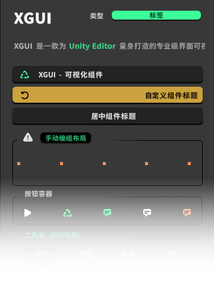
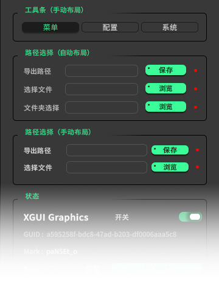
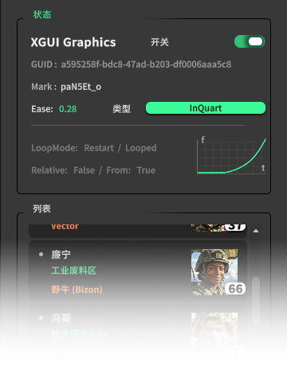
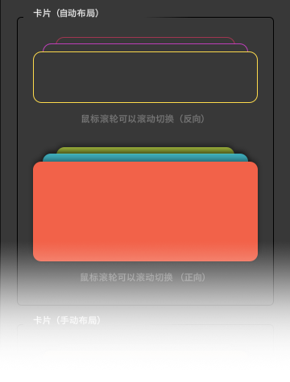
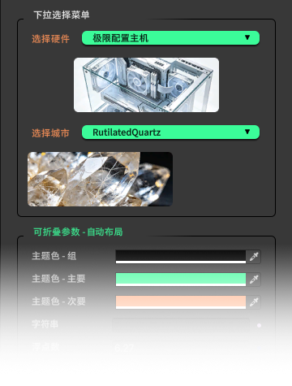
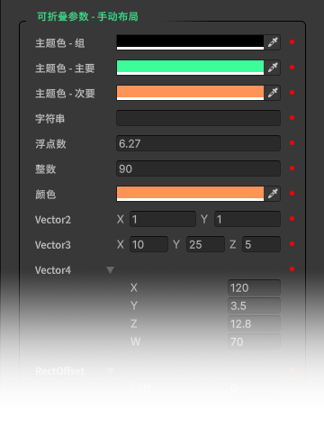
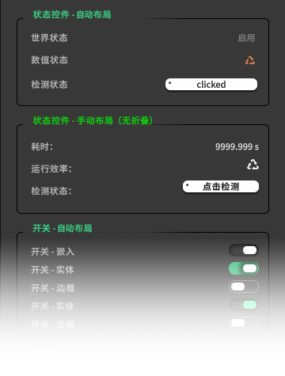
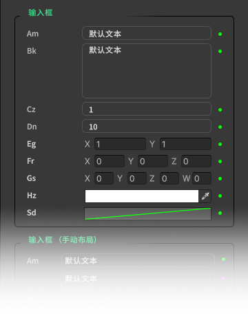
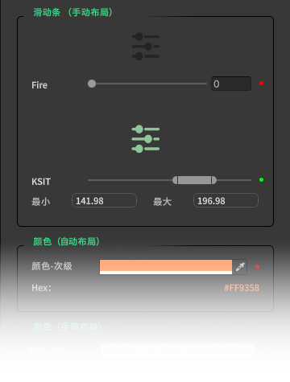

# XGUI

**Unity Editor 界面可视化组件工具** · *A visual GUI toolkit for Unity Editor*


> 一套皮肤，两种写法：`layout_*` 自动排版，`gui_*` 精确绘制。
> 控件、弹窗、卡片、图标、缓动曲线与编辑器内动效预览一次备齐。

XGUI 是一套面向 Unity Editor 扩展的界面可视化组件库。它让工具窗口与 Inspector 面板摆脱零散拼凑的 `GUIStyle`，在几分钟内拥有统一、精致的商业级外观。

<br>

| 开源不易，您的支持是持续更新的动力，<br>这个小工具倾注了我无数个深夜的调试与优化，它永远免费，但绝非无成本，如果您觉得这个工具<br>能为您节省时间、解决问题，甚至带来一丝愉悦，请考虑赞助一杯咖啡，让我知道：有人在乎这份付出，而这将成为我熬夜修复Bug、<br>添加新功能的最大动力。开源不是用爱发电，您的认可会让它走得更远| |
|:-|-:|
| **欢迎加入技术研讨群，在这里可以和我以及大家一起探讨插件的优化以及相关的技术实现思路，同时在做项目时遇到的众多问题以及瓶颈<br>阻碍都可以互相探讨学习**| |

组件覆盖从可折叠分组、模态弹窗、三层堆叠卡片到虚拟滚动列表，原生支持 `SerializedProperty`，并附带编辑器内动效预览、43 种缓动与特效曲线、6 款字重字体与 120+ 内置图标。`layout_*` 自动布局与 `gui_*` 精确绘制两套 API 可自由混用，从简单设置面板到完整工具窗口都能高效搭建。

- **命名空间**：`SevenStrikeModules.XGUI.Editor`（控件）、`SevenStrikeModules.XGUI.Runtime`（枚举、工具、曲线、数据）
- **程序集**：`XGUI.Editor`（仅 Editor）、`XGUI.Runtime`（运行时可用）
- **零配置**：首次调用自动加载皮肤、字体与纹理缓存，无需手动初始化

## 界面预览

<p align="center">
  
  
  
</p>

<p align="center">
  
  
  
</p>

<p align="center">
  
  
  
</p>
## 特性一览

**外观与设计语言**

- 内置 `XGUI.guiskin` 皮肤，控件风格统一，不依赖 Unity 默认皮肤
- **17 种主题色**与**5 种容器填充**（实体 / 边框 / 缺口边框 / 纯色边框 / 缺口纯色边框），内置 80 套预制底板贴图
- 按钮额外提供 3 种填充 + 透明样式，开关 3 种样式，卡片 2 种样式
- **6 款字重**内置 OTF 字体（`xg-thin` / `xg-light` / `xg-regular` / `xg-medium` / `xg-bold` / `xg-heavy`），9 档字号枚举
- 文本支持 Unity 富文本标签（`<b>`、`<color=#RRGGBB>`），可与主题色实时联动
- 120+ 张内置 PNG 图标素材，含按钮态（normal / pressed）成对图标、帮助框、对话框、头像与演示图标

**控件**

- 覆盖标签、按钮、横幅、帮助框、输入框、开关、滑块、下拉、颜色、曲线、色相条、属性框、工具栏、点击选择器、进度条、状态显示、卡片、分割线、间距、路径选择器、虚拟滚动列表
- 每个控件都有 **自动布局版（`layout_*`）** 与 **精确绘制版（`gui_*`）**，同一窗口可混用
- 分组容器支持**折叠**、标题栏、标题背景、标题图标、左右内边距与外边距的叠加/绝对模式
- 开关、滑块、下拉、属性框、颜色字段均支持 **`SerializedProperty`**，多选时开关自动显示 `—` 混合态并可一键统一
- 输入框支持 `string` / `float`(可设小数位) / `int` / `Vector2` / `Vector3` / `Vector4` / `Color` / `AnimationCurve`，手动版还支持 `Quaternion`
- 滑块支持 `float`、`int` 以及 **最小-最大双滑块**（返回 `xgui_minmax_value`）
- 卡片控件是**三层堆叠式卡片**，带左右箭头切换与高亮交互，适合做轮播式选项 / 资源浏览

**弹窗**

- 模态 / 非模态对话框，按钮数 1~5 个自动布局，6 种对话框类型（通知 / 确认 / 修改 / 警告 / 错误 / 帮助）
- 三种形态：标准对话框、**名称+描述提交框**（`dialog_submit`）、**列表选择框**（`dialog_listview`，内建可拖动排序列表）
- 主题色可传入任意 `Color`，支持回调与返回值两种取结果方式

**编辑器内动效预览（EditorPlayer）**

- `EditorPlayer_Values`：数值插值驱动器，支持 31 种缓动、步数/间隔/循环/往返
- `EditorPlayer_Sequence`：序列帧播放器，支持循环次数、手动 `Next()`
- `EditorPlayer_Sound`：编辑器内音效预览，支持延迟、音量、静音、随机音调与批量入队
- 三者共用 `EditorApplication.update` 驱动骨架，**无需进入 Play Mode** 即可预览效果

**缓动曲线**

- 43 种曲线类型，含标准缓动 + `Shake` / `Flash` / `Glitch` 等特效曲线
- 按指定关键帧数量（2~100）采样并自动写入切线，输出严格落在 `[0,1]×[0,1]`
- 生成结果可缓存为 `AnimationCurve`，直接用于 Inspector 曲线字段或自研动画插件

**工程化**

- 资源全部走 `AssetDatabase`，通过 `PackageInfo` 自动解析包根路径，本地 UPM 包与旧式 `Assets/` 目录都能正确加载
- 懒加载 + 纹理/字体/曲线字典缓存，重复绘制不反复读盘
- 提供 `XGUI_Utilitys` 工具库：颜色/向量/字符串互转、随机配色、亮度判定、统计、路径处理、剪贴板、方法计时、`EditorPrefs` / `PlayerPrefs` 读写
- 附带以 UPM Sample 形式提供的演示资产 `XGUISamples.asset` 与两个工具窗口，导入即可上手

---

## 环境与兼容

| 项目 | 说明 |
| --- | --- |
| Unity 版本 | `6000.0.38f1` 及以上（`package.json` 已声明） |
| 包管理器 | UPM，包名 `com.sevenstrike.xgui` |
| 依赖 | 无第三方依赖 |
| 运行平台 | 全部 Editor 平台（`XGUI.Editor` 程序集限制为 Editor） |
| 运行时 | `XGUI.Runtime` 不引用 `UnityEditor`，曲线生成与工具函数可在构建产物中复用 |
| 授权 | GNU AGPL-3.0 |

> 调用 XGUI 控件的脚本必须位于 `Editor` 目录或 Editor-only 程序集内，否则会因程序集隔离无法引用。

---

## 安装

### 方式 A：从本地磁盘添加（推荐）

1. 打开 `Window > Package Manager`
2. 点击左上角 `+`，选择 `Add package from disk...`
3. 选择 `com.sevenstrike.xgui/package.json`

### 方式 B：写入 `manifest.json`

编辑项目的 `Packages/manifest.json`，在 `dependencies` 中加入本文件夹的相对或绝对路径：

```json
{
  "dependencies": {
    "com.sevenstrike.xgui": "file:../com.sevenstrike.xgui"
  }
}
```

### 方式 C：通过 Git 安装

仓库地址：<https://github.com/SevenStrike/XGUI_UPM>。

**Git 安装地址**
在 Package Manager 中使用 `Add package from git URL...` 填入以下命令行即可；需要锁定版本时在命令行后追加 `#tag` （如 `#v1.0.0`）

```text
https://github.com/SevenStrike/XGUI_UPM.git?path=com.sevenstrike.xgui
```


### 方式 D：网络受限 / 无 Git 环境

在浏览器打开仓库页面，点击 `Code` → `Download ZIP`，解压后通过 `Add package from disk...` 选择解压目录中的 `com.sevenstrike.xgui/package.json`。这条路径完全不走 Unity 内的 git，国内网络或未安装 Git 的机器都能使用；缺点是不会随仓库更新自动升级。

---

## 快速开始

### 快速范例实现：一个带分组、开关、滑块、按钮的编辑器窗口

```csharp
using SevenStrikeModules.XGUI.Editor;
using SevenStrikeModules.XGUI.Runtime;
using UnityEditor;
using UnityEngine;

public class XGUI_Samples : EditorWindow
{
    public Color color_primary = Color.cyan;
    public Color color_secondary = Color.yellow;
    public Color color_group = Color.black * 0.75f;
    public Color color_sepline = Color.gray;
    private Color color_toggle_on;
    private Color color_toggle_off;

    private bool enableFeature;
    private float speed = 0f;
    private bool fold = true;

    private Texture2D icon_recycle;
    private Texture2D icon_warning;
    private Texture2D icon_dot;

    [MenuItem("Tools/XGUI/示例窗口")]
    private static void Open()
    {
        XGUI_Samples window = GetWindow<XGUI_Samples>("XGUI 示例");
        window.minSize = new Vector2(380, 200);
    }

    private void OnEnable()
    {
        icon_recycle = XGUI.GetBasedIcon("icon_recycle_r");
        icon_warning = XGUI.GetBasedIcon("icon_warning");
        icon_dot = XGUI.GetBasedIcon("icon_dot");

        color_toggle_on = XGUI_Utilitys.HexString_To_Color("3BFD9A");
        color_toggle_off = Color.white * 0.65f;
    }

    private void OnGUI()
    {
        fold = XGUI.layout_group_start(
            type: XGUIContainerType.Vertical,
            bg_fill: XGUIGroup.缺口纯色边框,
            bg_color: XGUIColor.亮白,
            bg_color_gui: color_group,
            title: "基础设置",
            title_text_color: Color.white,
            title_size: XGUIFontSize.M,
            padding: new RectOffset(10, 10, 20, 15),
            icon: icon_recycle,
            icon_color: XGUI.GetXGUIColor(XGUIColor.亮橘红),
            foldout: fold);

        if (fold)
        {
            enableFeature = XGUI.layout_toggle(
                title: "启用模块",
                title_width: 100,
                prop: enableFeature,
                tog_bg_off_color: color_toggle_off,
                tog_bg_on_color: color_toggle_on,
                tog_margin: new RectOffset(15, 0, 0, 0),
                tog_padding: new RectOffset(5, 5, 0, 0),
                tog_handler_off_color: Color.white,
                tog_handler_on_color: Color.white);

            XGUI.layout_space(5);

            speed = XGUI.layout_slider(
                title: "速度",
                prop: speed,
                left: 0,
                right: 100,
                title_width: 100,
                title_size: XGUIFontSize.M,
                title_anchor: TextAnchor.MiddleLeft,
                status_icon: "icon_dot",
                status_icon_color: Color.green,
                prop_margin: new RectOffset(0, 0, 5, 0));

            XGUI.layout_seperator(
                thickness: 1,
                color: Color.white * 0.5f,
                margin: new RectOffset(20, 20, 25, 15));

            if (XGUI.layout_button(
                text: "应用设置",
                bg_fill: XGUIGroup.实体,
                bg_color: XGUIColor.亮白,
                bg_color_gui: Color.white,
                button_text_color: Color.black,
                press_color: XGUIColor.深空灰,
                press_fill: XGUIGroup.实体,
                press_text_color: Color.white,
                height: 30,
                absolute_margin: true,
                absolute_padding: true,
                padding: new RectOffset(0, 0, 0, 0),
                margin: new RectOffset(0, 0, 0, 0)))
            {
                Debug.Log($"应用：{enableFeature} / {speed}");
            }
        }

        XGUI.layout_group_end(XGUIContainerType.Vertical);
    }
}
```

要点：`layout_group_start` 返回当前折叠状态，务必保存并在下次调用时传回 `foldout`；`layout_group_end` 必须与 `layout_group_start` 成对出现。

### 在 Inspector 中使用 SerializedProperty

```csharp
using SevenStrikeModules.XGUI.Editor;
using SevenStrikeModules.XGUI.Runtime;
using UnityEditor;
using UnityEngine;

[CustomEditor(typeof(MyComponent))]
public class MyComponentEditor : Editor
{
    public override void OnInspectorGUI()
    {
        serializedObject.Update();

        XGUI.layout_banner(
            bg_fill: XGUIGroup.实体,
            bg_color: XGUIColor.深空灰,
            bg_height: 30,
            icon: XGUI.GetBasedIcon("icon_strike"),
            title_text: "MyComponent 设置",
            title_color: Color.white,
            title_size: XGUIFontSize.B);

        XGUI.layout_toggle(title: "启用", prop: serializedObject.FindProperty("enable"), title_width: 80);
        XGUI.layout_slider(title: "强度", prop: serializedObject.FindProperty("strength"), left: 0f, right: 5f, title_width: 80);

        serializedObject.ApplyModifiedProperties();
    }
}
```

### 手动布局：按 Rect 精确摆放

`gui_*` 系列不做自动排版，所有位置由你决定，适合自定义窗口、自绘面板与叠加式布局。

```csharp
private void OnGUI()
{
    Rect panel = new Rect(20, 20, position.width - 40, 96);

    XGUI.gui_box(panel, bg: XGUI.GetGroupTexture(XGUIGroup.缺口纯色边框, XGUIColor.亮白));

    XGUI.gui_label(
        rect: new Rect(panel.x + 16, panel.y + 12, panel.width - 32, 24),
        text: new GUIContent("手动布局面板"),
        size: XGUIFontSize.L,
        text_color: Color.black,
        font: XGUI.GetFont("xg-bold"));

    if (XGUI.gui_button(
            rect: new Rect(panel.x + 16, panel.y + 52, 120, 26),
            text: "执行",
            btn_color: XGUIColor.柠檬绿,
            btn_text_color: Color.black))
    {
        Debug.Log("clicked");
    }
}
```

### API 命名速记

| 前缀 | 含义 |
| --- | --- |
| `layout_` | 基于 `GUILayout` / `EditorGUILayout` 的自动布局，跟着窗口流式排列 |
| `gui_` | 基于 `Rect` 的精确绘制，位置尺寸完全可控 |
| `toolbar_` | 用于自定义窗口顶部工具条的按钮与开关（带分隔线、`XGUIEdge` 边类型） |
| `dialog_` | 弹窗入口，按形态分为对话框 / 提交框 / 列表选择框 |
| `Get*` | 资源与样式获取（样式、字体、图标、填充纹理、主题色、缓动曲线） |

---

## 组件速查

`layout_*` 与 `gui_*` 功能对等，按你的排版需求选一即可；下表中 `—` 表示该控件只提供一种形态。

| 控件 | 自动布局 | 精确绘制 | 说明 |
| --- | --- | --- | --- |
| 分组容器 | `layout_group_start` / `layout_group_end`<br>`editor_layout_group_start` / `editor_layout_group_end` | `gui_group_start` / `gui_group_end` | 可折叠、带标题与图标，5 种填充；`editor_` 版返回分组 `Rect` |
| 区域 | `—` | `gui_area_start` / `gui_area_end` | 在指定矩形内建立独立的 `GUILayout` 区域，自带背景 |
| 背景块 | `—` | `gui_box` | 纯背景或纯色块，常用于自绘底板 |
| 标签 | `layout_label` | `gui_label` | 字号/颜色/对齐/裁剪/富文本/可点击回调 |
| 按钮 | `layout_button`（文本版 / 图标版） | `gui_button` | 支持 normal / pressed 两套底色与文字色，图标按钮可换按压贴图 |
| 横幅 | `layout_banner` | `—` | 标题条：背景 + 图标 + 文本，对齐与裁剪可调，适合做区块标题 |
| 帮助框 | `layout_helpbox` | `—` | 通知 / 警告 / 错误三态图标，可换标题样式与自动换行 |
| 图标 | `layout_icon` | `gui_icon` | 支持着色、内边距、边框与左/中/右对齐 |
| 输入框 | `layout_inputfield` | `gui_inputfield` | string / float / int / Vector2-4 / Color / AnimationCurve；手动版多 Quaternion |
| 开关 | `layout_toggle` | `gui_toggle` | 实体 / 嵌入 / 边框三样式；`SerializedProperty` 多选显示 `—` 并支持批量统一 |
| 滑块 | `layout_slider`<br>`layout_slider_int`<br>`layout_slider_min_max` | `gui_slider`<br>`gui_slider_min_max` | 单值、整型、双滑块区间 |
| 下拉 | `layout_int_popup`<br>`layout_string_popup` | `gui_int_popup`<br>`gui_string_popup` | 支持 `SerializedProperty`、自定义选项底色与箭头 |
| 颜色 | `layout_colorfield` | `gui_colorfield` | 当前色块 + 标题 + 可选 HEX 行（Alt 点击复制 HEX），点击打开 Unity 取色面板 |
| 曲线 | `—` | `gui_curvefield` | 带标题与当前状态的曲线字段，可回写 |
| 色相条 | `—` | `gui_hue_gradient` | 按属性色相绘制渐变条与标记，返回对应 `Color`（只读展示） |
| 属性框 | `layout_property_field` | `gui_property_field` | 统一属性行：标题 + 控件，支持悬停色 |
| 工具栏 | `layout_toolbar` | `gui_toolbar` | 普通模式与导航模式（整条边框 + 无按钮底色） |
| 点击选择器 | `layout_clickselector` | `—` | 一排图标按钮，按索引互斥选中 |
| 进度条 | `layout_progress` | `gui_progress` | 标题 + 副标题 + 左右渐变色 + 指针/箭头 + 前景/背景色 |
| 状态显示 | `layout_state_displayer_text`<br>`layout_state_displayer_icon`<br>`layout_state_displayer_btn` | `gui_state_displayer_text`<br>`gui_state_displayer_icon`<br>`gui_state_displayer_btn` | 左侧标题、右侧状态文本/图标/按钮 |
| 卡片 | `layout_card` | `gui_card` | 三层堆叠卡片，左右箭头切换，实体/边框两样式 |
| 分割线 | `layout_seperator` | `gui_seperator` | 水平 / 垂直，可调粗细与颜色 |
| 间距 | `layout_space` / `layout_flexspace` | `—` | 固定间距与弹性占位 |
| 路径选择器 | `layout_path_selector` | `gui_path_selector` | 文件 / 文件夹 / 文件或文件夹 / 保存文件，带浏览按钮与过滤器 |
| 虚拟滚动列表 | `—` | `gui_scrollview<T>` | 只绘制可见项，带高度缓存与脏标记，上下各留 2 项缓冲 |
| 窗口工具条 | `toolbar_button` / `toolbar_toggle` | `—` | 平面化工具条按钮，支持分隔线与边线类型（`XGUIEdge`） |

### 常用辅助 API

| API | 用途 |
| --- | --- |
| `XGUI.GetStyle(string)` | 取皮肤样式副本（`xg_group` / `xg_area` / `xg_button` / `xg_toggle` / `xg_input` / `xg_popup` / `xg_prop` / `xg_label` / `xg_box` / `xg_icon` / `xg_progress` / `xg_seperate` / `xg_toolbar` / `xg_toggle_handler`） |
| `XGUI.style_xg_*` | 直接读取上述样式的副本属性 |
| `XGUI.GetFont(string)` | 取内置字重字体，如 `XGUI.GetFont("xg-bold")` |
| `XGUI.GetGroupTexture(mode, color)` | 取容器填充纹理 |
| `XGUI.GetBtnFillTexture(mode, color)` | 取按钮填充纹理，`XGUIGroup.透明` 单独处理 |
| `XGUI.GetToggleBgTexture(style)` / `GetToggleHandlerTexture()` | 取开关底板与控制柄 |
| `XGUI.GetIcon(name)` / `GetBasedIcon(name)` | 取内置图标（前者支持子目录相对路径，后者为 Based 基础图标） |
| `XGUI.GetBuiltInIcon(iconName)` / `GetCustomIcon(path)` | 取 Unity 内建图标 / 取指定路径 PNG |
| `XGUI.GetXGUIColor(XGUIColor)` | 取主题色 `Color` |
| `XGUI.GetEaseCurve(EaseType)` | 取缓存后的缓动曲线 |
| `XGUI.GetLastRect()` / `GetControlRect()` / `GetRect()` | 布局矩形工具 |
| `XGUI.GetCurrentWindowWidth()` / `GetSingleLineHeight()` | 窗口宽度与单行高度 |
| `XGUI.CurrentWindowWidthThreshold(">", 800f)` | 响应式断点判断 |
| `XGUI.SetEnabled(bool)` | 批量禁用控件 |
| `XGUI.ChangedCheck_Start()` / `ChangedCheck_End()` | 变更检测包装 |
| `XGUI.BrowsePath(...)` | 打开系统文件/文件夹选择框 |
| `XGUI.CenterEditorWindow(size, window)` | 窗口居中并固定尺寸 |
| `XGUI.x_Editor_Data_*` | `EditorPrefs` 读写（Float / String / Int / Bool） |

---

## 设计系统

### 主题色（`XGUIColor`）

| 枚举 | HEX | 枚举 | HEX |
| --- | --- | --- | --- |
| 深空灰 | `#232323` | 亮橘红 | `#ff872e` |
| 阴影灰 | `#909090` | 枪灰 | `#747474` |
| 亮白 | `#e8e8e8` | 亮金色 | `#ffd86b` |
| 柠檬绿 | `#c9e63f` | 沉暗红 | `#a32a2a` |
| 工业蓝 | `#38aafb` | 烟灰蓝 | `#76829a` |
| 警示黄 | `#ffc230` | 健康绿 | `#4aeec9` |
| 玫瑰粉 | `#fa5d98` | 浅灰 | `#414141` |
| 神秘紫 | `#9e5afb` | 无 | 透明 / 不绘制 |
| 魅力红 | `#ff3737` | 灰绿 | `#94a565` |

颜色既可以走枚举（配合预生成纹理，性能最好），也可以直接传 `Color` 覆盖（`bg_color_gui`、`btn_color_gui`、`*_color` 一类参数），用于品牌色或运行时明暗适配。

### 填充样式（`XGUIGroup`）

| 枚举 | 效果 |
| --- | --- |
| 无 | 不绘制背景 |
| 实体 | 整块填充 |
| 边框 | 透明底 + 描边 |
| 缺口边框 | 描边，标题处留缺口 |
| 纯色边框 | 半透明底 + 描边 |
| 缺口纯色边框 | 半透明底 + 描边，标题处留缺口 |
| 透明 | 仅按钮可用，完全透明 |

### 开关与卡片样式

| 枚举 | 取值 |
| --- | --- |
| `XGUIToggleStyle` | 实体 / 嵌入 / 边框 |
| `XGUICardStyle` | 实体 / 边框 |
| `XGUIToggleHandlerState` | 开 / 关（决定控制柄阴影贴图） |

### 字号（`XGUIFontSize`）

| 枚举 | XS | S | M | B | BX | L | XL | XXL | XXXL |
| --- | --- | --- | --- | --- | --- | --- | --- | --- | --- |
| 像素 | 8 | 10 | 11 | 12 | 13 | 14 | 18 | 20 | 24 |

`B` 为标准正文，`M` 常用于标题与标签，`XXXL` 适合做封面式大标题。

### 字体

| 文件名 | 字重 |
| --- | --- |
| `xg-thin.otf` | 极细 |
| `xg-light.otf` | 细 |
| `xg-regular.otf` | 常规 |
| `xg-medium.otf` | 中等 |
| `xg-bold.otf` | 粗 |
| `xg-heavy.otf` | 特粗 |

`XGUI.GetFont("xg-bold")` 直接取用；字体缺失时会在控制台给出提示并返回 `null`，控件自动回落到皮肤默认字体。

---

## 对话框

### 标准对话框

```csharp
string result = XGUI.dialog(
    type: XGUIDialogType.警告,
    windowtitle: "确认删除",
    title: "删除资源",
    msg: "此操作不可撤销，确定继续吗？",
    ok: "删除",
    cancel: "取消",
    usemodal: true,
    themecolor: XGUI.GetXGUIColor(XGUIColor.魅力红),
    on_selected: r => Debug.Log($"用户选择：{r}"));

if (result == "删除")
{
    // 执行删除
}
```

- 按钮数量由传入的文本决定：`ok` → 1 个，再加 `cancel` → 2 个，依次到 `special` 共 5 个
- `PrimaryIndex` 指定默认高亮按钮
- 返回值就是被点击按钮的文本，同时也会触发 `on_selected`

### 提交框（名称 + 描述）

```csharp
XGUI.dialog_submit(
    type: XGUIDialogType.修改,
    windowtitle: "新建配置",
    title: "填写配置信息",
    msg: "名称与描述会写入配置文件",
    ok: "创建",
    cancel: "取消",
    arg_name_text: "名称",
    arg_data_text: "描述",
    on_selected: data =>
    {
        // data.state 为被点击按钮的文本（"创建" 或 "取消"）
        if (data.state == "创建")
            Debug.Log($"{data.name} / {data.description}");
    });
```

### 列表选择框

```csharp
XGUIDialogListDatas[] items =
{
    new XGUIDialogListDatas("主相机", "场景对象", "MainCamera"),
    new XGUIDialogListDatas("方向光", "场景对象", "Directional Light"),
};

XGUI.dialog_listview(
    datas: items,
    windowtitle: "选择目标",
    title: "请选择一个对象",
    msg: "列表项支持拖动排序",
    ok: "确定",
    cancel: "取消",
    themecolor: XGUI.GetXGUIColor(XGUIColor.工业蓝));
```

列表项结构为 `Title` / `SubTitle` / `Message` / `SourceObject`；对话框内部使用带自定义绘制的 `ReorderableList`，支持拖动排序与折叠。

---

## 卡片与虚拟列表

### 层叠卡片

`CardDataWrap` 维护数据数组与当前索引，卡片会自动绘制"后两层虚化 + 前层实心"的三层景深，并处理左右箭头的悬停与点击。

```csharp
XGUI.layout_card(
    data: cardData,
    style: XGUICardStyle.实体,
    card_height: 64,
    color_arrow_l: Color.white,
    color_arrow_r: Color.white,
    on_press_left: () =>
    {
        cardData.index = Mathf.Max(0, cardData.index - 1);
    },
    on_press_right: () =>
    {
        cardData.index = Mathf.Min(cardData._datas.Length - 1, cardData.index + 1);
    });
```

### 虚拟滚动列表

只绘制视口内的条目，适合几百上千行的配置表、资源浏览器。

```csharp
private Vector2 scroll;
private readonly List<float> heights = new List<float>();
private bool heightsDirty = true;

private void OnGUI()
{
    scroll = XGUI.gui_scrollview(
        rect: new Rect(0, 0, position.width, 320),
        scroll: scroll,
        list: items,
        cachedItemHeights: ref heights,
        heightsDirty: ref heightsDirty,
        onscroller: (rect, item, index) =>
        {
            XGUI.gui_label(
                rect: rect,
                text: new GUIContent(item),
                padding: new RectOffset(10, 10, 0, 0),
                text_color: Color.white);
        },
        fixheight: 30f);
}
```

`heightsDirty` 置 `true` 可强制重建高度缓存；视口上下各保留 2 项缓冲，快速滚动不闪白。

---

## EditorPlayer：编辑器内动效预览

三个 Player 都挂在 `EditorApplication.update` 上，由 `EditorApplication.timeSinceStartup` 计时，**不用进 Play Mode**。

### 数值插值

适合做参数试调、预览条、颜色渐变、位置游走。

```csharp
XGUI.EditorPlayer_Values.Play(
    from: 0f,
    to: 1f,
    lerp: (a, b, t) => Mathf.Lerp(a, b, t),
    stepCount: 60,
    interval: 1f / 60f,
    onStep: (t, value) =>
    {
        preview = value;
        Repaint();
    },
    loopCount: 0,          // -1 无限；0 播一遍；N 播 N+1 遍
    pingPong: false,       // true 往返
    ease: XGUIEaseMode.OutCubic);

// 任意时刻读取
float now = XGUI.EditorPlayer_Values.CurrentValue<float>();
float t = XGUI.EditorPlayer_Values.CurrentT;
```

- `lerp` 由你提供，因此 `float` / `Vector2` / `Vector3` / `Color` / `Quaternion` 都能用
- `XGUIEaseMode` 提供 31 种标准缓动，也可传 `customCurve` 使用自定义 `AnimationCurve`
- 单例驱动：再次 `Play` 会替换当前播放内容，`Stop()` 清空并摘除 tick

### 序列帧

```csharp
XGUI.EditorPlayer_Sequence.Play(
    frames: frames,        // List<Texture2D>
    interval: 0.08f,
    onFrame: Repaint,
    loopCount: 0);

Texture2D current = XGUI.EditorPlayer_Sequence.Current;
int index = XGUI.EditorPlayer_Sequence.CurrentIndex;

// 手动推进一帧（尊重 loopCount）
XGUI.EditorPlayer_Sequence.Next();
```

### 音效预览

```csharp
XGUI.EditorPlayer_Sound.Enqueue(
    clip: clip,
    delay: 0.2f,
    volume: 1f,
    mute: false,
    useRandomPitch: false,
    pitchMin: 0.95f,
    pitchMax: 1.05f);

// 批量错峰播放（0.0s / 0.3s / 0.6s）
XGUI.EditorPlayer_Sound.Enqueue(clipA, 0f, 1f, false, false, 1f, 1f);
XGUI.EditorPlayer_Sound.Enqueue(clipB, 0.3f, 1f, false, false, 1f, 1f);
XGUI.EditorPlayer_Sound.Enqueue(clipC, 0.6f, 1f, false, false, 1f, 1f);

XGUI.EditorPlayer_Sound.Stop();
```

> 完整交互演示：菜单 `Tools > XGUI > EditorPlayer 完整测试窗口`

---

## 缓动曲线

`XGUI_EaseCurveGenerator` 位于运行时程序集，可同时服务于编辑器与游戏逻辑。

```csharp
// 生成 30 个关键帧的曲线
AnimationCurve curve = XGUI_EaseCurveGenerator.EaseType_Generate(EaseType.OutBack, 30);

// 直接给 Inspector 曲线字段使用
myComponent.curve = curve;

// 编辑器内取缓存曲线（20 帧采样）
AnimationCurve cached = XGUI.GetEaseCurve(EaseType.OutCubic);
```

- 曲线族：`Linear` 与 Sine / Quad / Cubic / Quart / Quint / Expo / Circ / Back / Elastic / Bounce，每族含 `In` / `Out` / `InOut` 三个方向，共 31 条标准缓动
- 特效曲线：`Shake`、`ShakeX`、`ShakeY`、`Flash`、`PulsingShake`、`SmoothShake`、`SharpFlash`、`Glitch`、`FlashThenFade`、`FlashThenFadeOut`、`BrightPulse`、`FlashHoldFade`
- 采样数会被夹在 `2~100`，每个关键帧写入解析切线并设为平滑模式，保证插值顺滑
- `XGUI_EaseCurveGenerator.EaseTypes_Get()` 可拿到全部枚举，便于做下拉选择

---

## 工具函数（`XGUI_Utilitys`）

| 分类 | 代表 API |
| --- | --- |
| 颜色解析 | `String_To_Color`、`HexString_To_Color`、`RGBA_To_Color`、`StringArray_To_Color`、`FloatArray_To_Color`、`IntArray_To_Color`、`HSV_To_Color` |
| 颜色导出 | `Color_To_HexString`、`Color_To_String`、`Color_To_StringArray`、`Color_To_FloatArray`、`Color_To_IntArray` |
| 亮度 | `ColorBrightness_Get`、`ColorBrightness_LimiteGet`（自动黑/白前景色） |
| 配色 | `RandomRGB`、`RandomVivid`、`RandomPastel`、`RandomDark`、`SetSaturation`、`ReduceSaturation` |
| 向量互转 | `Vector2/3/4_To_String`、`*_To_FloatArray`、`String_To_Vector*`、`FloatArray_To_Vector*` 等 |
| 布尔 | `String_To_Bool`、`String_To_BoolArray` |
| 字符串 | `ParenthesesCleaner`、`RemoveCloneSuffix`、`GameObject_SuffixName_Cleaner`、`GenerateUniqueId`、`Unescape` |
| 剪贴板 | `CopyToSystemBuffer` |
| 统计 | `MinValue`、`MaxValue`、`Average`、`Mode`、`Odd`、`Even`、`Negative`、`IndexOf` |
| 路径 | `ToRelativePath`、`ToAbsolutePath`、`PathExists`、`IsPathInProject` |
| 延时 | `MethodStopwatch(Action)` |
| 存储 | `x_Runtime_Data_*`（`PlayerPrefs`）、`XGUI.x_Editor_Data_*`（`EditorPrefs`） |
| 杂项 | `Console(title, content, state)` 带色控制台输出、`OpenURL`、`Sorting` |

```csharp
Color theme = XGUI_Utilitys.HexString_To_Color("#3BFD9A");
string hex = XGUI_Utilitys.Color_To_HexString(theme, true);   // "#3BFD9A"
bool isBright = XGUI_Utilitys.ColorBrightness_LimiteGet(theme); // 亮色返回 true
```

---

## 图标体系

| API | 图标来源 | 用法 |
| --- | --- | --- |
| `XGUI.GetIcon("Samples/Icons/icon_slider")` | `Icons/` 下任意相对路径 | 支持子目录，自动补 `.png` |
| `XGUI.GetBasedIcon("icon_play_r")` | `Icons/Based/` | 基础图标，带缓存 |
| `XGUI.GetBuiltInIcon("console.infoicon")` | Unity 内建图标 | 直接取 `EditorGUIUtility.IconContent` |
| `XGUI.GetCustomIcon("Assets/Art/MyIcon")` | 项目内任意路径 | 自动补 `.png` |
| `XGUI.GetHelpboxStateIcon(state)` | `Icons/Helpbox/` | 通知 / 警告 / 错误 |

内置 Based 图标涵盖播放 / 停止 / 前进 / 倒退 / 重播、加号、清空、路径、对话框、圆点、定位、上下左右箭头、警示、删除线等；`Icons/Based/` 下另有 `Anchor`、`EaseGraph` 两个专用子目录。

> 浏览全部 Unity 内建图标：菜单 `Tools > XGUI > UnityBuiltinIconsGet Unity内建图标合集获取器`

---

## 示例与工具入口
> 演示资产以 UPM Sample 形式随包分发。首次使用请打开 `Window > Package Manager`，在 XGUI 的 **Samples** 区域点击 **Import**，导入后位于 `Assets/Samples/XGUI/1.0.0/SevenStrikeModules/XGUI/`，可自由修改。

| 入口 | 位置 | 说明 |
| --- | --- | --- |
| XGUI 组件总览 | Package Manager → XGUI → Samples → **Import**，再选中 `Assets/Samples/XGUI/1.0.0/SevenStrikeModules/XGUI/Sample/XGUISamples.asset` | 自定义 Inspector 演示主要控件、布局与手动绘制写法 |
| EditorPlayer 测试窗口 | `Tools > XGUI > EditorPlayer 完整测试窗口` | 数值 / 音效 / 序列帧三个面板的完整交互 |
| 内建图标浏览器 | `Tools > XGUI > UnityBuiltinIconsGet ...` | 检索 Unity 内建图标名称 |
| 新建示例资产 | 右键 `Create > XGUI > CreateSamples` | 生成一份 `XGUI_Samples` 数据资产 |

---

## 目录结构

```
com.sevenstrike.xgui/
├─ Fonts/                 6 款字重 OTF 字体
├─ GUI/                   XGUI.guiskin 皮肤文件
├─ Icons/                 Based / Helpbox / Dialogs / Avatars / Samples
├─ Shapes/                Group / Button / Toggle / Card / Inputfield / Separator 贴图
├─ Scripts/
│  ├─ Runtime/            XGUI_Dashboard、XGUI_Utilitys、XGUI_Enums、XGUI_EaseCurveGenerator
│  └─ Editor/             GUI（gui_*）、Layout（layout_*）、Dialog、Toolbar、EditorPlayer、Tools
├─ Samples~/              UPM 示例（Import 前不参与编译）
│  └─ SevenStrikeModules/XGUI/
│     ├─ Sample/          XGUISamples.asset 演示资产
│     └─ Scripts/         演示数据类与两个自定义 Inspector
├─ package.json           UPM 描述
├─ CHANGELOG.md
└─ LICENSE.md             AGPL-3.0 全文
```

---

## 注意事项

1. **仅限编辑器界面**：所有 GUI 控件属于 `XGUI.Editor` 程序集，业务脚本需放在 `Editor` 目录或 Editor-only 程序集。
2. **不要拆散资源目录**：皮肤、字体、图标、贴图通过包内相对路径加载，移动 `XGUI.guiskin` 或 `Fonts` / `Icons` / `Shapes` 会导致控件失去外观。
3. **颜色参数留空即用默认**：`bg_color_gui`、`title_text_color` 等传 `default` 或 `Color.clear` 时，控件会回落到白色或皮肤默认值，不必逐个指定。
4. **折叠状态要自己保存**：`layout_group_start` 的返回值就是折叠状态，下一次绘制必须原样传回。
5. **成对调用**：`layout_group_start` / `gui_group_start` / `gui_area_start` 必须与对应的 `end` 成对出现。
6. **多选混合态**：基于 `SerializedProperty` 的开关在多对象编辑时会显示 `—`，点击后可从 `tog_mixed_options` 中选择统一值。
7. **预留接口**：`layout_listview` 目前为空实现，列表请使用 `gui_scrollview` 或对话框的列表模式。
8. **版本信息**：`CHANGELOG.md` 与 `package.json` 中的版本、描述建议同步维护，Package Manager 展示的是 `package.json` 的 `description`。

---

## 授权

本项目遵循 **GNU Affero General Public License v3.0（AGPL-3.0）**。

- 可自由使用、修改、分发源代码，但必须保留文件头部的版权注释
- 基于本项目的衍生作品需同样以 AGPL-3.0 发布
- 若以网络服务形式提供（如云端编辑器、在线动效工具），需公开修改后的完整源代码

如需闭源商用或定制授权，请先与作者联系确认授权方式。完整协议文本：<https://www.gnu.org/licenses/agpl-3.0.html>

---

## 关于

| | |
| --- | --- |
| 作者 | 徐寅智（Isaac.Xu） |
| 团队 | 南京塞维斯传媒有限公司（SevenStrikeMedia） |
| 官网 | <http://sevenstrike.com/> |
| 仓库 | <https://github.com/SevenStrike/XGUI_UPM> |
| 相关插件 | XTween、XHUD、XGUI、XBinder、XGraph |
| 版权 | Copyright (C) 2025-Present Nanjing SevenStrike Media Co., Ltd. |
